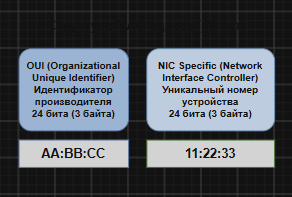
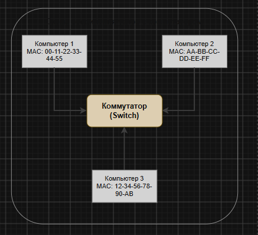
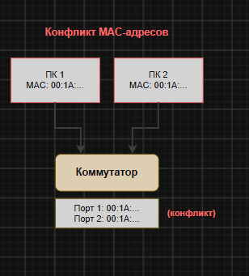

# 1. Схема MAC-адреса

MAC-адрес представляет собой персональный аппаратный идентификатор сетевого оборудования. Он имеет длину 48 бит (что эквивалентно 6 байтам) и записывается в шестнадцатеричной системе счисления.

**Структура:**

| MAC-address: 48 бит | |
| :--- | :--- |
| Первые 3 байта  (OUI — производитель) | Последние 3 байта  (уникальный серийный номер) |
| AA:BB:CC | 11:22:33 |

**Пример:** `00:1A:2B:3C:4D:5E`

| Часть | Значение | `00:1A:2B` | Код производителя (OUI) | `3C:4D:5E` | Серийный номер устройства |
| :--- | :--- | :--- | :--- | :--- | :--- |

---

## Типы адресов

* **Unicast** — адрес, принадлежащий одному конкретному устройству.
* **Multicast** — адрес, предназначенный для группы сетевых устройств.
* **Broadcast** — широковещательный адрес — `FF:FF:FF:FF:FF:FF`.

---

## Схема соединения компьютеров через коммутатор

### Схема

---

## Как работает коммутатор

1. Коммутатор фиксирует в памяти MAC-адрес каждого подключенного устройства и соответствующий ему номер порта.
2. Когда ПК-1 направляет информацию в адрес ПК-3, коммутатор обращается к своей таблице и перенаправляет пакет данных строго на нужный порт.
3. Если адрес назначения неизвестен системе, коммутатор производит рассылку (broadcasting) на все порты до тех пор, пока получатель не ответит.

---

## Таблица MAC-адресов коммутатора

| Порт | MAC-адрес | Устройство |
| :--- | :--- | :--- |
| 1 | 00:1A:2B:3C:4D:5E | ПК-1 |
| 2 | 00:1A:2B:3C:4D:5F | ПК-2 |
| 3 | 00:1A:2B:3C:4D:60 | ПК-3 |
| 4 | 00:1A:2B:3C:4D:61 | ПК-4 |

---

## Ошибка: конфликт MAC-адресов

**Причины:**
* системный администратор вручную задал одинаковые MAC-адреса на разных устройствах;
* была скопирована виртуальная машина без предварительного изменения её MAC-адреса;
* MAC-адрес был подменен программным способом.

---

## Схема проблемы

---

## Что происходит

Коммутатор теряет понимание того, на какой именно порт следует направлять трафик. Из-за этого сетевые кадры начинают циклически «перебрасываться» между портами, соединение пропадает или функционирует с перебоями, а оба задействованных компьютера теряют возможность нормально взаимодействовать с сетью.

---

## Как исправить

1. **Обнаружение конфликта:** откройте таблицу MAC-адресов коммутатора. Если один и тот же MAC-адрес зафиксирован за двумя разными портами одновременно, это указывает на ошибку.
2. **Изменение MAC-адреса** на одном из проблемных устройств:
   * **Windows:** Диспетчер устройств $\to$ Сетевая плата $\to$ Свойства $\to$ Дополнительно $\to$ Network Address $\to$ укажите новое значение MAC.
   * **Linux:** выполнить команду `sudo ip link set dev eth0 address 00:1A:2B:3C:4D:99`.
   * **Виртуальная машина:** сгенерируйте новый MAC-адрес в сетевых настройках виртуальной машины.
3. **Проверка:** после внесения изменений таблица коммутатора актуализируется, и конфликт будет устранен.

---

## Профилактика

* избегайте ручного назначения одинаковых MAC-адресов без острой необходимости;
* обязательно меняйте MAC-адрес при любом клонировании виртуальных машин;
* задействуйте DHCP-протокол и статическую привязку IP-адресов к MAC-адресам на стороне коммутатора.