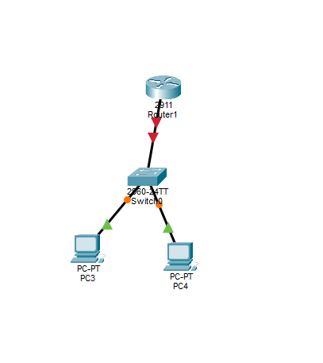
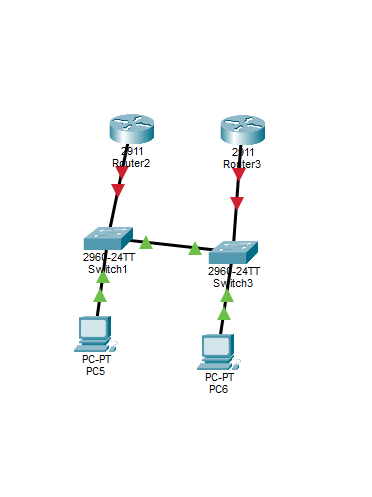
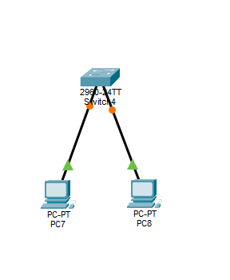

**Описание схем:**

*   **Схема 1:** Маршрутизация между подсетями.

    

*   **Схема 2:** Настройка статической маршрутизации между двумя роутерами.

    

*   **Схема 3:** Настройка безопасности портов.

    