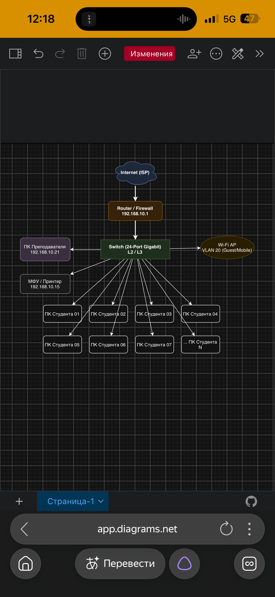

# Отчет по сетевой топологии лаборатории

## 1. Введение
В данном отчете представлена схема организации локальной сети учебного класса или лаборатории, разработанная в графическом редакторе **app.diagrams.net** (draw.io). Топология объединяет сетевое оборудование, рабочие места студентов, преподавателя, периферийные устройства и беспроводной сегмент.

---

## 2. Архитектура сети и компоненты

### 2.1. Шлюз и выход в Интернет
* **Internet (ISP)** — внешний поставщик услуг связи.
* **Router / Firewall** — маршрутизатор и межсетевой экран.
  * **IP-адрес шлюза:** `192.168.10.1`
  * Отвечает за фильтрацию трафика и маршрутизацию пакетов между локальной сетью и глобальной сетью Интернет.

### 2.2. Коммутационное ядро
* **Switch (24-Port Gigabit) L2 / L3** — центральный коммутатор сети.
  * Обеспечивает объединение всех узлов в едином сегменте (или через виртуальные локальные сети VLAN).

### 2.3. Рабочие станции и периферия
* **ПК Преподавателя:** `192.168.10.21` (выделенный узел административного контроля).
* **МФУ / Принтер:** `192.168.10.15` (сетевое печатающее устройство).
* **ПК Студентов (01 — N):** Рабочие станции учащихся, подключенные к коммутатору для выполнения лабораторных и практических заданий.

### 2.4. Беспроводной сегмент
* **Wi-Fi AP (VLAN 20):** Точка доступа для гостевых и мобильных устройств, изолированная в отдельной виртуальной сети VLAN 20.

---

## 3. Таблица IP-адресации

| Устройство / Сегмент | IP-адрес / Интерфейс | Назначение |
| :--- | :--- | :--- |
| **Router / Firewall** | `192.168.10.1` | Шлюз по умолчанию, межсетевой экран |
| **ПК Преподавателя** | `192.168.10.21` | Рабочее место преподавателя |
| **МФУ / Принтер** | `192.168.10.15` | Сетевой принтер |
| **ПК Студентов (01–N)** | Динамические / Статические | Рабочие места учащихся |
| **Wi-Fi AP** | VLAN 20 | Беспроводной сегмент (Guest / Mobile) |

---

## 4. Заключение
Представленная топология демонстрирует классическую структуру локальной вычислительной сети (ЛВС) с централизованной коммутацией, разделением прав доступа (через VLAN для Wi-Fi) и наличием шлюза безопасности. Схема может использоваться в качестве основы для настройки маршрутизаторов и коммутаторов в лабораторных работах по дисциплине «Компьютерные сети».

## 5. схема организации учебного класса
